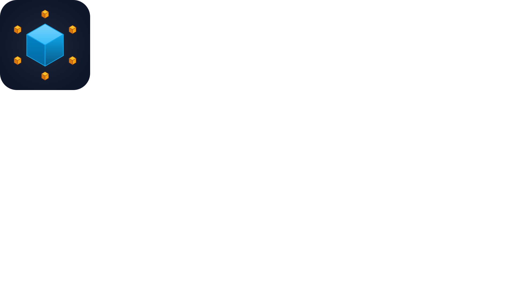
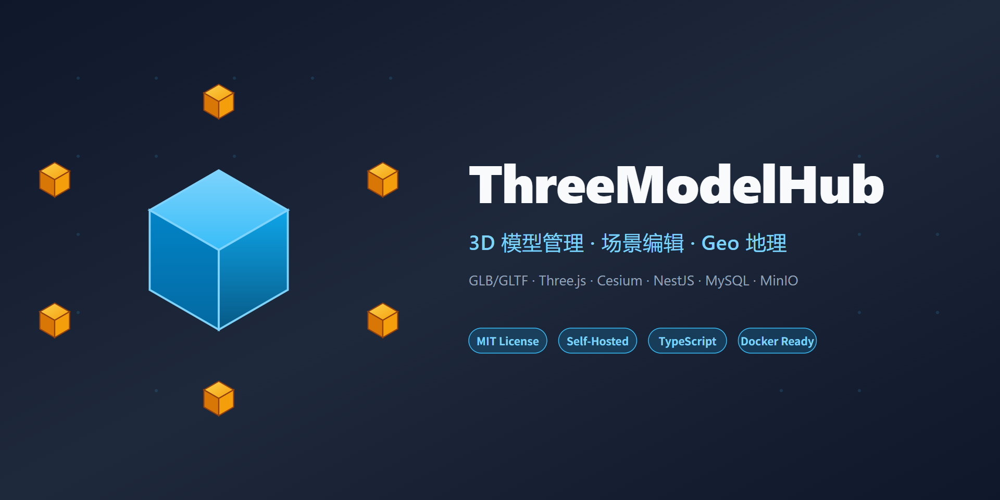

# three-model-hub



[](LICENSE)
[](https://github.com/shawn-web/three-model-hub/actions/workflows/ci.yml)
[](https://www.typescriptlang.org/)
[](#docker-快速部署)
[](https://threejs.org/)
[](https://nestjs.com/)

> 主仓库：[Gitee](https://gitee.com/lishuaistart/three-model) ｜ 镜像：[GitHub](https://github.com/shawn-web/three-model-hub)

> 全栈 3D 模型管理与场景平台：上传 GLB/GLTF，组合场景，添加标注和测量，部署 Geo 地理视图，通过 iframe 嵌入到任何系统。



## ✨ 核心功能

- **📦 模型管理**：GLB/GLTF 模型上传、版本控制、缩略图预览
- **🎬 场景编辑器**：多模型组合、变换编辑（位置/旋转/缩放）、材质覆盖、图片标注
- **🛰️ Geo 地理视图**：基于 Cesium 的 3D 地球，支持模型地理定位、底图配置、标点
- **🔍 3D 查看器**：基于 Three.js + React Three Fiber 的交互式渲染，支持 12 种插件（测量、剖面、透视、自动旋转等）
- **📍 视点保存**：保存和恢复相机视角
- **💬 批注系统**：在 3D 场景中添加文本批注
- **🔗 场景分享**：通过 Token 机制分享场景链接
- **📁 资源管理**：通用文件资源分组管理，支持图片/视频预览
- **🪟 iframe 嵌入**：支持将查看器嵌入第三方页面，通过消息总线通信

## 🛠️ 技术栈

| 层级 | 技术 |
|------|------|
| 前端框架 | React 19 + TypeScript |
| 构建工具 | Vite 8 |
| 3D 渲染 | Three.js + React Three Fiber + Drei |
| 地理引擎 | Cesium |
| UI 组件 | Ant Design 6 + Tailwind CSS |
| 状态管理 | Zustand（zundo 提供撤销/重做） |
| 后端框架 | NestJS 11 |
| 对象存储 | MinIO（S3 兼容） |
| 定时任务 | @nestjs/schedule |
| 数据库 | MySQL 8.0 + TypeORM |
| 包管理 | pnpm workspaces |

## 🚀 快速开始

### 环境要求

- Node.js 20.x LTS
- pnpm 9.x
- MySQL 8.0
- Docker（推荐，用于 MySQL / MinIO）

### 5 分钟快速启动（开发模式）

```bash
# 1. 克隆仓库
git clone https://gitee.com/lishuaistart/three-model.git
cd three-model

# 2. 安装依赖
pnpm install

# 3. 启动 MySQL（Docker）
docker-compose up -d mysql

# 4. 启动 MinIO（无 Docker 方式）
pnpm minio:start

# 5. 复制后端环境变量并修改
cp backend/.env.example backend/.env
# 编辑 backend/.env，至少修改 DB_PASSWORD、MINIO_ACCESS_KEY、MINIO_SECRET_KEY

# 6. 初始化数据库（首次启动）
cd backend && pnpm migration:run && cd ..

# 7. 一键启动前后端
pnpm dev:full
```

启动后访问：

- 前端：http://localhost:5173
- 后端 API：http://localhost:3000/api
- MinIO 控制台：http://localhost:9001（默认 `minioadmin / minioadmin123`）

### Docker 部署（生产模式）

**方式一：拉取镜像直接部署（不需要源码）**

```bash
curl -O https://gitee.com/lishuaistart/three-model/raw/master/docker-compose.prod.yml
curl -o .env https://gitee.com/lishuaistart/three-model/raw/master/.env.docker.example
# 编辑 .env，填好 DB_PASSWORD / MYSQL_ROOT_PASSWORD / MINIO_ACCESS_KEY / MINIO_SECRET_KEY
docker compose -f docker-compose.prod.yml up -d
```

打开 `http://<服务器IP>:8080`。镜像为多架构（amd64 / arm64），MySQL、MinIO、后端、前端一次起齐，对外只暴露一个端口。

镜像地址由 `.env` 的 `IMAGE_NAMESPACE` 决定，默认 `ghcr.io/shawn-web`。若该地址上还没有镜像（例如 CI 被账号状态阻塞），用下面方式二从源码构建，或按 [`docs/docker-deploy.md`](docs/docker-deploy.md) 第八节自行发布到阿里云 ACR 等仓库后改回来。

**方式二：从源码构建镜像**

```bash
docker compose -f docker-compose.deploy.yml up -d --build
```

镜像仓库不限于 ghcr.io，换成阿里云 ACR / 腾讯云 TCR / 华为云 SWR 只需改 `IMAGE_NAMESPACE` 一行。注意 **Gitee 不提供镜像仓库**（制品库是企业版付费功能，社区版无 Registry 端点），具体对比见文档第八节。

> 环境变量、HTTPS、备份升级、常见问题详见 [`docs/docker-deploy.md`](docs/docker-deploy.md)

## 📁 项目结构

```
three-model-hub/
├── frontend/        # React SPA（Vite）
│   ├── src/
│   │   ├── api/       # API 请求层
│   │   ├── components/# 可复用组件
│   │   ├── pages/     # 页面组件
│   │   ├── store/     # 状态管理
│   │   ├── core/      # 核心模块（插件管理器、查看器）
│   │   ├── plugins/   # 12 个查看器插件
│   │   ├── loaders/   # 模型加载器
│   │   ├── communication/ # iframe 通信协议
│   │   └── theme/     # 主题配置
│   └── tests/         # 单元测试（Vitest）
├── backend/         # NestJS API
│   ├── src/
│   │   ├── models/    # 模型管理
│   │   ├── scenes/    # 场景管理
│   │   ├── geo-maps/  # 地理地图管理
│   │   ├── sharing/   # 分享功能
│   │   ├── viewpoints/# 视点保存
│   │   ├── annotations/# 批注系统
│   │   ├── resources/ # 资源管理
│   │   ├── upload/    # 文件上传
│   │   ├── storage/   # 文件存储服务
│   │   └── minio/     # MinIO 基础设施
│   └── test/          # e2e 测试（Jest）
├── docs/            # 项目文档
│   ├── api.md         # API 文档
│   ├── architecture.md# 架构文档
│   ├── development.md # 开发指南
│   ├── deployment.md  # 部署文档
│   └── geo-improvement-plan.md # Geo 模块迭代计划
├── docker-compose.yml       # MySQL 开发环境
├── docker-compose.deploy.yml # 生产部署方案
├── nginx/                   # Nginx 反向代理配置
├── .github/
│   ├── assets/      # Logo / 社交预览图
│   ├── workflows/   # CI/CD
│   └── ISSUE_TEMPLATE/
└── package.json     # 根目录脚本（pnpm workspaces）
```

## 📜 常用命令

| 命令 | 说明 |
|------|------|
| `pnpm dev:full` | 一键启动 MinIO + MySQL + 前后端 |
| `pnpm dev:all` | 启动前后端（需先启动 MinIO + MySQL） |
| `pnpm dev` | 启动前端开发服务 |
| `pnpm build` | 构建前端生产版本 |
| `pnpm backend:dev` | 启动后端开发服务 |
| `pnpm backend:test` | 运行后端测试（Jest） |
| `cd frontend && pnpm test:run` | 运行前端测试（Vitest） |
| `pnpm minio:start` | 启动 MinIO（数据存 `.minio-data/`） |
| `pnpm minio:status` | 检查 MinIO 健康状态 |
| `pnpm minio:stop` | 停止 MinIO 进程 |
| `pnpm minio:reset` | 清理 MinIO 数据 |
| `docker-compose up -d` | 启动 MySQL 容器 |

## 🌐 浏览器兼容性

three-model-hub 需要支持 **WebGL 2.0** 的现代浏览器：

- Chrome / Edge 90+
- Firefox 88+
- Safari 14+

> **不支持** IE 和旧版 Edge。移动端仅查看模式可用，编辑器模式需要桌面端。

## 📚 文档

- [API 文档](docs/api.md) — 后端 API 接口详情
- [架构文档](docs/architecture.md) — 系统架构、模块划分、核心流程
- [开发指南](docs/development.md) — 环境搭建、代码规范、添加新功能
- [部署文档](docs/deployment.md) — 裸机 + PM2 的传统部署步骤
- [Docker 部署](docs/docker-deploy.md) — 拉取镜像直接部署、环境变量、HTTPS、备份升级
- [测试文档](docs/testing.md) — 测试策略、单元/e2e 运行方法与前置条件
- [iframe 嵌入集成指南](docs/iframe-integration.md) — 路由、URL 参数、postMessage 协议与安全模型
- [Geo 改进计划](docs/geo-improvement-plan.md) — Geo 模块迭代记录

## 🤝 贡献

欢迎通过 Issue 报告 Bug、提出功能建议，或直接提交 PR。

- 阅读 [CONTRIBUTING.md](CONTRIBUTING.md) 了解开发规范
- 阅读 [架构文档](docs/architecture.md) 了解代码组织
- 提交前请运行 `pnpm test:all` 确保测试通过

## 📄 许可证

本项目基于 [MIT](LICENSE) 许可证开源。

## 🙏 致谢

- [Three.js](https://threejs.org/) — 3D 渲染引擎
- [Cesium](https://cesium.com/) — 3D 地理可视化
- [NestJS](https://nestjs.com/) — Node.js 服务端框架
- [Ant Design](https://ant.design/) — UI 设计语言
- 所有为开源生态贡献的依赖项目
